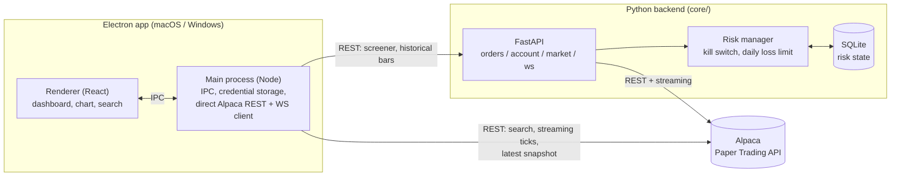

# Architecture

This document covers how Tide Trader is put together and, more importantly,
*why* — the tradeoffs behind the less obvious decisions. For setup and usage,
see the [README](../README.md).

## System overview

Two independent processes, two different jobs:

**The Electron app talks to Alpaca directly for realtime data**, and to the
Python backend for screener/historical data. That split looks inconsistent at
first glance — here's why it's there.

## Why two backends talking to Alpaca instead of one

This project grew in phases, and the split is a real artifact of that, not
an accident:

1. **Phase 1** was a pure Electron app — search, watchlist, realtime streaming,
   all driven directly from the main process straight to Alpaca's REST/WebSocket
   APIs. Credentials never leave the main process; the renderer only ever sees
   IPC-shaped data. This still works and is what powers the live price header
   and realtime ticks today.
2. **Phase 2** introduced the Python backend (`core/`) specifically to own
   **order execution and risk management** — a kill switch, a daily-loss
   limit, and persisted state are things you want in one well-tested place,
   not duplicated in TypeScript, and `alpaca-py` plus FastAPI is a better fit
   for that logic than doing it in Node. This is also where an eventual
   trading agent will plug in (see [Roadmap](#roadmap)), since it needs a
   backend it can call into on its own, independent of whether the desktop
   app is even open.
3. **The market-research endpoints** (most-active, movers, historical bars)
   were added to the Python backend rather than the Electron main process
   because they belong next to the same Alpaca market-data client the
   backend already has for order-pricing checks, and because the dashboard
   was always meant to become the human-in-the-loop review surface for the
   agent in (2) — better for it to already be talking to that backend.

**The realtime streaming path was deliberately left alone** rather than
migrated to route through the Python backend too. It already worked, gave the
UI true zero-hop latency IEX ticks, and rebuilding a WebSocket relay through a
second process would have added a hop for no immediate benefit — the payoff
(a single Alpaca connection shared across every future client, including a
future phone app) only starts to matter once there's more than one client. If
that need materializes, this is the natural next thing to unify.

## Component breakdown

### Electron app (`src/`)

- **`main/`** — the only place Alpaca credentials and the API secret ever
  live in plaintext, in memory only, never on disk. Handles:
  - `alpacaCredentialCache.ts` — a module-level, in-memory-only credential
    cache (no file I/O at all) for the direct-to-Alpaca streaming path below.
    Cleared on Electron restart; there is no persistence layer to clear.
  - `alpacaRest.ts` / `alpacaStream.ts` — direct REST search + WebSocket
    streaming client for realtime trades/quotes/bars.
  - `backendClient.ts` — a fetch wrapper for the Python backend's
    market-research and Alpaca-connection endpoints, attaching the shared
    access token (see Security model) to every request.
  - `index.ts` — IPC handler registration, wiring both of the above to the
    renderer. The `alpaca:save-credentials` handler calls the backend's
    `POST /api/v1/alpaca/connect` to validate + connect, then mirrors the
    same credential into `alpacaCredentialCache` purely so the direct
    streaming path has its own copy — the backend never hands the secret
    back to Electron.
- **`preload/`** — the only bridge between renderer and main, via
  `contextBridge`. The renderer never gets raw `ipcRenderer`/Node access.
- **`renderer/`** — React UI: `DiscoverPanel` (screeners), `SymbolDetail` +
  `PriceChart` (live price + historical chart), `SearchBar`,
  `CredentialsForm` (onboarding).
- **`shared/types.ts`** — the one source of truth for message shapes crossing
  the main/renderer boundary.

### Python backend (`core/app/`)

- **`adapters/`** — one class per external concern, each behind a narrow
  `Protocol` so tests can substitute a fake without touching the network:
  - `alpaca_trade.py` — orders, account, positions; reads latest price for
    market-order risk checks.
  - `alpaca_market.py` — screeners (most-active, movers) and historical bars.
  - `alpaca_data.py` — the live IEX streaming hub (`MarketDataHub`), with
    reference-counted symbol subscriptions so Alpaca is only ever told about
    a symbol while at least one WebSocket client actually wants it.
- **`engine/`** — `risk_manager.py` (pre-trade checks + kill switch) and
  `state_store.py` (the SQLite persistence underneath it). Deliberately
  separated: the risk manager holds policy, the state store holds
  persistence, and neither needs to know the other's internals.
- **`security/`** — `access_token.py` (the shared-secret check protecting
  every REST route except `/ws/live`) and `alpaca_session.py` (`AlpacaConnection`,
  the single in-memory slot holding the Alpaca Key ID/Secret and the
  adapters built from them, populated by `POST /api/v1/alpaca/connect` and
  wiped on process restart or `DELETE /api/v1/alpaca/disconnect`).
- **`routers/`** — thin FastAPI route handlers; all real logic lives in
  adapters/engine/security so it's unit-testable without spinning up the app.
  `alpaca_connection.py` is the one exception to "no logic in routers": it
  probes a candidate credential against real Alpaca before committing it.
- **`main.py`** — lifespan wiring: loads/creates the access token, constructs
  the (initially empty) `AlpacaConnection` and the risk manager once at
  startup and hangs them off `app.state`, rather than re-constructing
  per-request. Unlike before, no Alpaca adapter is built here — that only
  happens once a user connects at runtime.

## Security model

This app is single-tenant per laptop: whoever runs a given backend process is
the only person it ever serves, so there is no login/account system. What it
does guard against is a *different* local process poking at an API that can
place real (paper) trades, and against ever writing the Alpaca secret
somewhere it could leak from.

- **The Alpaca Key ID/Secret are never persisted anywhere** — not encrypted,
  not in a keyring, not in a file, not in a database. Both the backend
  (`AlpacaConnection`, in `app/security/alpaca_session.py`) and the Electron
  main process (`alpacaCredentialCache.ts`) hold it only in that process's own
  memory, for as long as that process keeps running. A backend restart or an
  Electron restart wipes its own copy and requires reconnecting through
  `CredentialsForm` again — there is deliberately no "reveal" endpoint that
  would let one process hand the raw secret back to the other.
- **A shared access token gates the REST API.** On first run the backend
  generates `secrets.token_urlsafe(32)` and writes it to
  `~/.tide-trader/access-token` (`0o600`; on Windows,
  `%USERPROFILE%\.tide-trader\access-token`, where `chmod` can't express
  owner-only access and the file instead relies on the user profile's NTFS ACL,
  which already limits it to that user, SYSTEM and Administrators). Electron reads the same
  well-known path and sends it as `Authorization: Bearer <token>` on every
  request. This is not a user-identity system — it's a single shared secret
  answering "is the caller our own Electron app," so no other local process
  can silently call an API that can move money (even paper money) or read
  account state. `/ws/live` is deliberately excluded (see `routers/stream.py`)
  since a bearer header doesn't map onto a WebSocket handshake, and it only
  fans out already-public market ticks.
- **`core/.env` never carries the Alpaca secret.** It only configures
  `ALPACA_PAPER`, risk limits, and network/DB settings; `.env.example`
  (placeholders only) is the one committed. Credentials are connected at
  runtime via `POST /api/v1/alpaca/connect`, never read from environment
  variables.
- **The renderer never sees the API secret.** Both the direct-Alpaca path and
  the Python-backend path are reached only through the main process; the
  contextBridge API only ever returns already-fetched data.
- **The Python backend binds to `127.0.0.1` by default**, not `0.0.0.0` —
  it can place real (paper) orders, so it isn't designed to be reachable from
  anything but the desktop app on the same machine. CORS is closed by default
  (`ALLOWED_ORIGINS` is empty) since the Electron main process calls it
  server-to-server and sends no `Origin` header.
- **Dockerized runs preserve the same posture**: the container listens on
  `0.0.0.0` internally (required for Docker's port publishing to work at
  all), but `docker-compose.yml` publishes that port bound to `127.0.0.1` on
  the host, not `0.0.0.0` — so the security boundary moves from the app to
  Docker's port mapping, rather than disappearing.

### Why not Docker for the desktop app

Docker on macOS runs inside a Linux VM with no access to macOS's native
windowing system (Cocoa/Quartz) — an Electron GUI app can't render a window
from inside a container without X11/VNC forwarding hacks, and even then
you'd be running a Linux build of Electron, not a native Mac app. Docker is
the right tool for the **backend service** (see `core/Dockerfile` and
`core/docker-compose.yml`) precisely because it's a headless server process
with no GUI — the two halves of this app have different distribution needs,
and only one of them fits a container.

## Risk management design

The risk manager enforces two things before any order reaches Alpaca:

1. **Position size cap** — `qty * price <= MAX_POSITION_DOLLARS`. For market
   orders (no `limit_price` to check against), the backend fetches the
   latest trade price first so the cap is enforced against a real number, not
   skipped because the order type doesn't carry a price.
2. **Daily loss limit** — drawdown is tracked against the first equity value
   seen each day (`day_start_equity`). Crossing `DAILY_LOSS_LIMIT_PCT` doesn't
   just reject that one order — it flips the kill switch, so every
   subsequent order is blocked until a human resets it.

Both the kill-switch state and the daily-drawdown baseline are persisted to a
SQLite file (`DB_PATH`) rather than kept in memory, specifically so a service
restart can't silently erase a halt that was put in place for a reason.

## Testing strategy

- **Adapters are tested against real alpaca-py request/response shapes**,
  captured by introspecting the installed library, not guessed — a fake
  client stands in for the network call, but the shapes it's asked to
  produce match what Alpaca actually returns.
- **The streaming hub's thread-safety is tested directly**: alpaca-py's
  stream client runs its own event loop in a background thread, so
  `MarketDataHub.publish_threadsafe` (using `call_soon_threadsafe`) is
  exercised from an actual second thread in tests, not just called inline.
- **Routers are tested through FastAPI's `TestClient` with dependency
  overrides** — real HTTP/WebSocket request handling, fake adapters
  underneath.
- The backend suite (`core/tests/`) sits at 100% line coverage; that's a
  by-product of testing behavior thoroughly, not a target chased with
  throwaway tests — see `core/tests/conftest.py` for the shared fixtures.

## Known limitations

- No manual order-placement UI yet — the backend's `/api/v1/orders` and
  `/api/v1/kill-switch` endpoints are fully built and tested but unused by
  the desktop app.
- Realtime data is IEX-only (free tier), not the full consolidated SIP feed —
  fine for research, not a substitute for a professional data feed.
- The Python backend has no auto-launch story yet — you start it by hand
  before opening the desktop app.
- The pre-trade risk check prices market orders off a quote fetched moments
  before submission, not the actual fill price - the real notional of a
  filled market order can end up slightly over `MAX_POSITION_DOLLARS` if the
  price moves in between. Accepted for now; tightening it would mean adding a
  post-fill reconciliation check, which doesn't exist yet.
- Electron is pinned to the 43.x line, not latest. Electron 44 raised its
  minimum macOS version to 13 (Ventura) - it links against `SMAppService`
  from macOS's ServiceManagement framework unconditionally, so it hard-crashes
  at launch (`dyld: Symbol not found: _OBJC_CLASS_$_SMAppService`) on macOS 12
  and older. Discovered empirically (binary search across major versions)
  while bumping Electron for unrelated CVE fixes; found no advance notice of
  this in the version we tried to jump to. Revisit this pin once the
  project's minimum supported macOS version moves to 13+.

## Roadmap

The direction this is heading: an agent that watches market data and
proposes trades, with a human approving before anything executes. The
Python backend's risk manager and order-execution path are already built to
be the safety layer under that agent, regardless of whether a human or an
agent is the one deciding *what* to trade — they just haven't been wired to
a decision-making component yet. The dashboard is meant to grow into that
approval surface. Beyond that: an iOS companion app, most likely sharing the
Python backend rather than duplicating the Electron main process's direct
Alpaca client.
